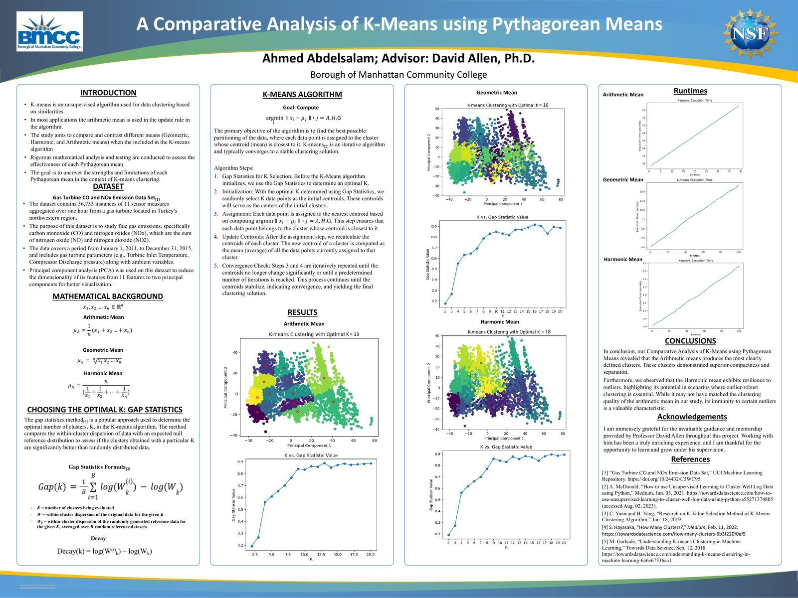

# A Comparative Analysis of K-Means Using Pythagorean Means

K-means almost always moves each centroid to the **arithmetic** mean of its
cluster. This project asks what happens when that update step uses the other
two Pythagorean means, **geometric** and **harmonic**, instead.

Undergraduate data science research supported by the National Science
Foundation (summer 2023) at Borough of Manhattan Community College, advised by
David Allen, Ph.D.

- 1st place, college research poster session (2023)
- Presented at the Joint Mathematics Meetings (JMM), January 2024

[Open the full-resolution poster (PDF)](A%20Comparative%20Analysis%20of%20K-means%20using%20Pythagorean%20Means.pdf)

## Approach

1. **Data.** The [Gas Turbine CO and NOx Emission Data Set](https://doi.org/10.24432/C5WC95)
   from the UCI Machine Learning Repository: 36,733 hourly records of 11 sensor
   measurements from a gas turbine in northwestern Turkey, 2011 to 2015.
2. **Dimensionality reduction.** Principal component analysis projects the 11
   features onto two principal components for clustering and visualization.
3. **Choosing K.** The gap statistic compares within-cluster dispersion against
   a random reference distribution to pick the number of clusters for each
   variant.
4. **Clustering.** Standard K-means (random initialization, nearest-centroid
   assignment, iterate to convergence) with three interchangeable centroid
   update rules:

   | Update rule | Centroid of points x1 ... xn |
   |---|---|
   | Arithmetic mean | (x1 + x2 + ... + xn) / n |
   | Geometric mean | (x1 x2 ... xn)^(1/n) |
   | Harmonic mean | n / (1/x1 + 1/x2 + ... + 1/xn) |

   The geometric and harmonic means are defined for positive values only.

5. **Evaluation.** Cluster compactness and separation, plus execution time per
   iteration.

## Results

| Update rule | Optimal K (gap statistic) |
|---|---|
| Arithmetic mean | 13 |
| Geometric mean | 16 |
| Harmonic mean | 18 |

- The **arithmetic mean** produced the most clearly defined clusters, with the
  best compactness and separation.
- The **harmonic mean** proved more resilient to certain outliers. Its
  clustering quality was lower overall, but that robustness is valuable where
  outlier-resistant clustering matters.

## Author

Ahmed Abdelsalam, with guidance from David Allen, Ph.D., Borough of Manhattan
Community College.

## References

1. "Gas Turbine CO and NOx Emission Data Set," UCI Machine Learning Repository. https://doi.org/10.24432/C5WC95
2. A. McDonald, "How to use Unsupervised Learning to Cluster Well Log Data using Python," Medium, 2021.
3. C. Yuan and H. Yang, "Research on K-Value Selection Method of K-Means Clustering Algorithm," 2019.
4. S. Hayasaka, "How Many Clusters?," Medium, 2022.
5. M. Garbade, "Understanding K-means Clustering in Machine Learning," Towards Data Science, 2018.
