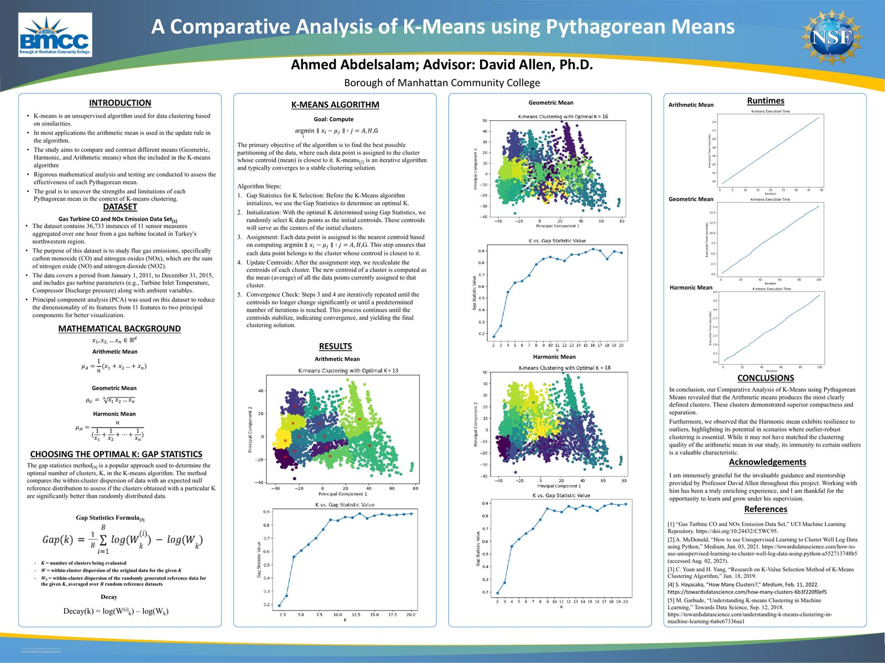
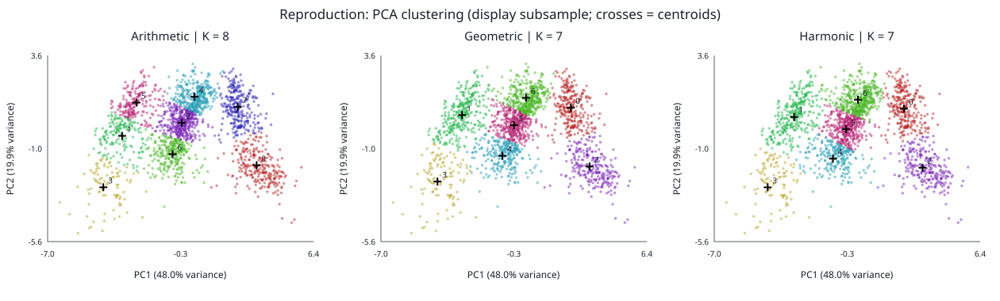

# A Comparative Analysis of K-Means Using Pythagorean Means

[](https://github.com/Bakar404/A-Comparative-Analysis-of-K-means-Using-Pythagorean-Means/actions/workflows/ci.yml)
[](LICENSE)
[](A%20Comparative%20Analysis%20of%20K-means%20using%20Pythagorean%20Means.pdf)

## Overview

This repository preserves the original research poster and adds a small,
seeded Python **reproduction**, not an exact replication of its numerical
results. The package uses NumPy and scikit-learn only; figures are generated
as SVG without an additional plotting library.

K-means almost always moves each centroid to the **arithmetic** mean of its
cluster. This project asks what happens when that update step uses the other
two Pythagorean means, **geometric** and **harmonic**, instead.

Undergraduate data science research supported by the National Science
Foundation (summer 2023) at Borough of Manhattan Community College, advised by
David Allen, Ph.D.

- 1st place, college research poster session (2023)
- Presented at the Joint Mathematics Meetings (JMM), January 2024

[](A%20Comparative%20Analysis%20of%20K-means%20using%20Pythagorean%20Means.pdf)

[Open the full-resolution poster (PDF)](A%20Comparative%20Analysis%20of%20K-means%20using%20Pythagorean%20Means.pdf)

## Approach

1. **Data.** The [Gas Turbine CO and NOx Emission Data Set](https://doi.org/10.24432/C5WC95)
   from the UCI Machine Learning Repository: 36,733 hourly records of 11 sensor
   measurements from a gas turbine in northwestern Turkey, 2011 to 2015.
2. **Dimensionality reduction.** Principal component analysis projects the 11
   features onto two principal components for clustering and visualization.
3. **Choosing K.** The gap statistic compares within-cluster dispersion against
   a random reference distribution to pick the number of clusters for each
   variant.
4. **Clustering.** Standard K-means (seeded k-means++ initialization, nearest-centroid
   assignment, iterate to convergence) with three interchangeable centroid
   update rules:

   | Update rule | Centroid of points x1 ... xn |
   |---|---|
   | Arithmetic mean | (x1 + x2 + ... + xn) / n |
   | Geometric mean | (x1 x2 ... xn)^(1/n) |
   | Harmonic mean | n / (1/x1 + 1/x2 + ... + 1/xn) |

   The geometric and harmonic means are defined for positive values only.

5. **Evaluation.** Cluster compactness and separation, plus execution time per
   iteration.

## Method

For a cluster of $n$ points, apply each formula separately to every feature
$j$:

$$
\mu_{A,j} = \frac{1}{n}\sum_{i=1}^{n}x_{i,j}
$$

$$
\mu_{G,j} = \left(\prod_{i=1}^{n}x_{i,j}\right)^{1/n}
= \exp\left(\frac{1}{n}\sum_{i=1}^{n}\log x_{i,j}\right)
$$

$$
\mu_{H,j} = \frac{n}{\sum_{i=1}^{n}1/x_{i,j}}
$$

The poster restricts its mathematical inputs to positive real numbers but
**does not specify non-positive handling**, including after PCA. The package
shifts any non-positive feature to minimum 1 when fitting geometric/harmonic
variants, stores the fitted `shift_`, and exposes centers in the original
coordinates. The standalone `centroid` helper instead rejects non-positive
geometric/harmonic inputs. Prediction uses original-coordinate Euclidean
distances and does not refit the shift.

For the experiment, all three variants receive the **same** positive-shifted
PCA scores. This is an explicit reproduction assumption, not a claim about
the original implementation. Translation leaves arithmetic K-means unchanged
but changes geometric/harmonic updates; the offset matters.

Initialization defaults to seeded **k-means++**; `init="random"` retains uniform
sampling of distinct data rows. Empty centers are reseeded at farthest points,
and fully occupied starts are preferred. Five starts (`n_init=5`) are tried for
final fits and ten (`n_init=10`, configurable with `--n-init`) for gap estimation,
with at most 300 iterations and absolute centroid tolerance `1e-4`.
If a selected fit still has an empty cluster, the experiment and gap helper
retry with another seed up to five times (`--max-retries`), recording failed
attempts in metadata and raising on exhaustion rather than treating K-1
occupied clusters as K. The selected complete start has the smallest squared distance to its
variant's centroids. Geometric/harmonic updates do not generally minimize
Euclidean SSE, so monotonic improvement is not guaranteed; a non-converged
selected run emits a warning and sets `converged_ = False`.

The gap helper uses the mean of reference **log dispersions**, with uniform
references inside the two-dimensional bounding box. Dispersion is the
standard within-cluster pairwise squared dispersion, equivalently SSE about
each partition's arithmetic centers, even for the other update rules.
Standard errors are `sqrt(1 + 1/B)` times the population standard deviation of
the B reference log dispersions (divisor B, `ddof=0`), following Tibshirani,
Walther & Hastie (2001).
The helper defaults to the local **one-SE** rule: the first
`Gap(k) >= Gap(k+1) - s(k+1)`. The experiment defaults to
**Dudoit & Fridlyand (2002)**: the smallest K with
`Gap(k) >= max(Gap) - s(argmax(Gap))`. This global one-SE rule avoids treating
the raw maximum as a precise cluster count. `--selection max` chooses the
smallest K attaining the maximum gap; `--selection one_se` uses the local rule.
An unresolved upper search boundary is flagged. All three choices are saved
from the same gap table regardless of the rule used for final fitting.

## Reproduce

Python 3.11 or newer is required. Run these four commands from the repository
root (the first run downloads the public UCI archive into ignored `.cache/`):

```bash
python3 -m venv .venv
.venv/bin/python -m pip install -r requirements.txt -e .
.venv/bin/python -m pytest -q
OPENBLAS_NUM_THREADS=1 OMP_NUM_THREADS=1 .venv/bin/python experiments/compare.py
```

Defaults use **all 36,733 rows and all 11 columns** from the five annual UCI
CSV files, standardize features, and fit full-SVD PCA to two components.
Standardization is another assumption: the poster does not give its scaling
recipe. Gap estimation tests K=1 through 20 on a seeded 2,000-row subset with
10 reference datasets; final clustering uses the full dataset. Seed: 2023.
The paper does not supply its seed, reference count/distribution, stopping
tolerance, initialization count, or original code.

The script overwrites artifacts only in `assets/results/<dataset>/`
(`gas_turbine/` by default); `--output-dir` changes the parent results directory.
The UCI archive's SHA-256 is pinned and checked for both downloads and cached
copies; a mismatch fails loudly. `metadata.json` records the checksum,
versions, parameters, shift, convergence, empty-cluster retries, timings, and
all three selected K values; `gap.csv` records every tested gap, standard error,
and observed dispersion, and `selected_k.csv` records every selection rule.
`--dataset iris` and `--dataset wine` provide offline alternatives, explicitly
**not datasets from the paper**, saved separately in `iris/` and `wine/` so they
never overwrite the README's gas-turbine artifacts. Numerical output may vary across dependency
versions; timing is machine-dependent. CI runs pytest on Python 3.11 and 3.12.

## Results

### Original poster

The following original results and conclusions are retained unchanged.

| Update rule | Optimal K (gap statistic) |
|---|---|
| Arithmetic mean | 13 |
| Geometric mean | 16 |
| Harmonic mean | 18 |

- The **arithmetic mean** produced the most clearly defined clusters, with the
  best compactness and separation.
- The **harmonic mean** proved more resilient to certain outliers. Its
  clustering quality was lower overall, but that robustness is valuable where
  outlier-resistant clustering matters.

### Reproduction



| Mean | K (gap) | Silhouette ↑ | Davies–Bouldin ↓ | Calinski–Harabasz ↑ | Dispersion ↓ | Iterations | Seconds/iteration | Converged |
|---|---:|---:|---:|---:|---:|---:|---:|---|
| Arithmetic | 8 | 0.4272 | 0.7856 | 47275.75 | 27406.41 | 50 | 0.0096 | yes |
| Geometric | 7 | 0.4400 | 0.7289 | 47379.88 | 31390.08 | 37 | 0.0086 | yes |
| Harmonic | 7 | 0.4369 | 0.7296 | 46655.51 | 31820.92 | 45 | 0.0083 | yes |

These are generated **reproduction** numbers, not the paper's numbers.
Silhouette and the displayed scatter use the same 2,000-row subset;
Davies–Bouldin, Calinski–Harabasz, and dispersion use all rows in PCA space.
PCA retains approximately 67.9% of standardized-feature variance. Crosses
mark centroids; axes show unshifted PCA scores. Individual panels are saved
as [arithmetic.svg](assets/results/gas_turbine/arithmetic.svg),
[geometric.svg](assets/results/gas_turbine/geometric.svg), and
[harmonic.svg](assets/results/gas_turbine/harmonic.svg).
The timing column averages fit wall time over iterations across all five
starts, including initialization/final-assignment overhead; the iterations
column refers only to the selected start.

All three rules were evaluated on the same saved gap estimates:

| Mean | Dudoit–Fridlyand (default) | Maximum gap | Local one-SE |
|---|---:|---:|---:|
| Arithmetic | 8 | 9 | 1 |
| Geometric | 7 | 8 | 1 |
| Harmonic | 7 | 8 | 1 |

The default selected K values, **8/7/7**, are within one standard error of
each other on each mean's gap curve: the gap difference between K=7 and K=8
is 0.0094/0.0085/0.0119, below the respective standard errors at K=8
(0.0137/0.0125/0.0175). They are **not statistically distinguishable by this
one-SE criterion**; this is a heuristic, not a formal test of equal cluster
counts. The raw maximum choices are not the default fitted K values.

The K values **do not match** the poster's 13/16/18. Arithmetic has lower
dispersion, but geometric has the highest silhouette and Calinski–Harabasz
and lowest Davies–Bouldin here. Different K values confound a direct quality
ranking. The poster provides qualitative compactness/separation and a runtime
plot, but no tabulated numerical quality scores or reproducible timing setup.
These results do not establish its claimed arithmetic-quality ranking or
harmonic outlier robustness; no controlled outlier experiment is performed.
The local one-SE rule selects K=1 throughout, for which separation metrics
would be undefined. See the [generated metric table](assets/results/gas_turbine/metrics.md),
[gap table](assets/results/gas_turbine/gap.csv),
[all three rules' selections](assets/results/gas_turbine/selected_k.csv), and
[provenance](assets/results/gas_turbine/metadata.json) for the saved main run.

## Author

Ahmed Abdelsalam, with guidance from David Allen, Ph.D., Borough of Manhattan
Community College.

## References

1. "Gas Turbine CO and NOx Emission Data Set," UCI Machine Learning Repository. https://doi.org/10.24432/C5WC95
2. A. McDonald, "How to use Unsupervised Learning to Cluster Well Log Data using Python," Medium, 2021.
3. C. Yuan and H. Yang, "Research on K-Value Selection Method of K-Means Clustering Algorithm," 2019.
4. S. Hayasaka, "How Many Clusters?," Medium, 2022.
5. M. Garbade, "Understanding K-means Clustering in Machine Learning," Towards Data Science, 2018.
6. R. Tibshirani, G. Walther, and T. Hastie, "Estimating the number of clusters in a data set via the gap statistic," 2001. https://doi.org/10.1111/1467-9868.00293
7. S. Dudoit and J. Fridlyand, "A prediction-based resampling method for estimating the number of clusters in a dataset," 2002. https://doi.org/10.1186/gb-2002-3-7-research0036

## Citation

```bibtex
@misc{abdelsalam2024pythagorean,
  author = {Ahmed Abdelsalam},
  title = {A Comparative Analysis of K-Means using Pythagorean Means},
  year = {2024},
  howpublished = {Research poster presented at the Joint Mathematics Meetings},
  note = {NSF-supported undergraduate research, Borough of Manhattan
          Community College; advisor David Allen; research conducted in 2023},
  url = {https://github.com/Bakar404/A-Comparative-Analysis-of-K-means-Using-Pythagorean-Means}
}
```

## License

Code is released under the [MIT License](LICENSE), copyright (c) 2026
Ahmed Abdelsalam. The downloaded UCI dataset retains its upstream terms and
is not redistributed in this repository.
